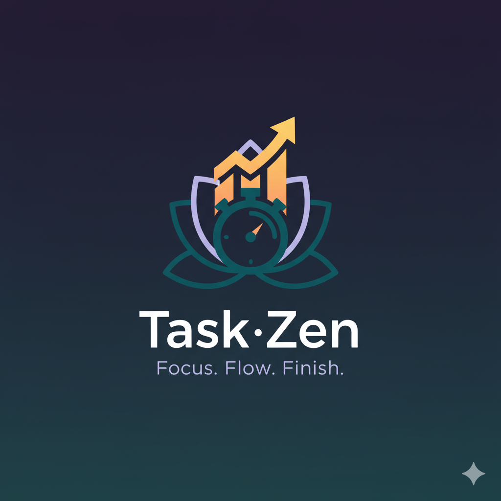

<div align="center">



# TaskZen

**Gestión de tareas con tablero Kanban, temporizador Pomodoro y priorización con IA.**


</div>

---

## Sobre el proyecto

TaskZen es una aplicación web full-stack de productividad. Junta en un solo sitio la gestión de tareas (Kanban), la técnica Pomodoro y un panel de métricas, y añade un asistente de IA que reprioriza las tareas pendientes.

Es un proyecto personal desarrollado de principio a fin: diseño de la base de datos, API REST, autenticación propia con JWT, interfaz y despliegue.

### Funcionalidades

| Módulo | Qué incluye |
| --- | --- |
| **Landing** | Página de presentación con animaciones (Framer Motion) |
| **Autenticación** | Registro e inicio de sesión con email y contraseña, contraseñas con bcrypt, sesión JWT de 7 días y rutas protegidas con middleware |
| **Tablero Kanban** | Columnas *Por hacer / En progreso / Hecho*, drag & drop, creación y edición de tareas con prioridad, fecha límite y Pomodoros estimados |
| **Priorización con IA** | Un flujo de Genkit + Gemini 2.0 Flash analiza las tareas y propone una nueva prioridad para cada una |
| **Temporizador Pomodoro** | Duraciones de trabajo y descanso configurables, alarma sonora y notificaciones del navegador |
| **Dashboard** | Tarjetas de estadísticas, gráfico de actividad con selector de fechas y gráfico de donut por prioridad (Recharts) |
| **Ajustes** | Preferencias por usuario guardadas en base de datos: duraciones Pomodoro, notificaciones y tema claro/oscuro |

---

## Stack tecnológico

- **Frontend:** Next.js 15 (App Router, Turbopack), React 18, TypeScript, Tailwind CSS, shadcn/ui (Radix UI), Framer Motion, Recharts
- **Drag & drop:** Atlassian Pragmatic Drag and Drop
- **Formularios y validación:** React Hook Form + Zod
- **Backend:** Route Handlers de Next.js (API REST)
- **Base de datos:** MongoDB Atlas con Prisma ORM
- **Autenticación:** JWT (`jose`) + `bcryptjs`, cookie de sesión validada en middleware
- **IA:** Genkit con Google AI (Gemini 2.0 Flash)

---

## Arquitectura

```
src/
├── ai/                     # Genkit: configuración y flujo de priorización de tareas
├── app/
│   ├── (auth)/             # /login y /signup
│   ├── (main)/             # Rutas protegidas: dashboard, board, timer, settings
│   ├── api/                # API REST: auth, tasks, dashboard, user preferences
│   └── page.tsx            # Landing
├── components/             # Componentes por módulo (board, dashboard, pomodoro, settings) + ui/
├── contexts/               # AuthContext (estado de sesión en cliente)
├── lib/                    # AuthService, servicios de dominio, cliente Prisma, server actions
└── middleware.ts           # Redirecciones según el estado de autenticación
prisma/
├── schema.prisma           # Modelos User, Task y UserPreferences
└── seed.ts                 # Usuario y tareas de ejemplo
```

**Decisiones de diseño:**

- **Capa de servicios** (`TaskService`, `AuthService`, `profileService`): los Route Handlers solo validan la petición y delegan, así la lógica de negocio queda separada del transporte HTTP.
- **Autenticación sin dependencias externas:** JWT firmado con HS256 mediante `jose` (compatible con el runtime Edge del middleware) y una caché en memoria de tokens ya verificados para no repetir la verificación en cada petición.
- **Aislamiento de datos:** todas las consultas de tareas filtran por el `userId` sacado del token, nunca por un valor enviado por el cliente.
- **IA tolerante a fallos:** si la llamada a Gemini falla, se devuelven las tareas originales y la interfaz sigue funcionando.

---

## Puesta en marcha

### Requisitos

- Node.js 18 o superior
- Una base de datos MongoDB (por ejemplo un clúster gratuito de [MongoDB Atlas](https://www.mongodb.com/atlas)). Prisma necesita que MongoDB funcione como *replica set*; Atlas ya lo hace por defecto.
- Una API key de Gemini ([Google AI Studio](https://aistudio.google.com/app/apikey)), solo para la priorización con IA

### 1. Clonar e instalar

```bash
git clone https://github.com/davidgzdeveloper/taskZen.git
cd taskZen
npm install          # también ejecuta `prisma generate`
```

### 2. Variables de entorno

Crea un archivo `.env` en la raíz:

```bash
# Cadena de conexión de MongoDB (incluye el nombre de la base de datos)
MONGODB_URL="mongodb+srv://<usuario>:<password>@<cluster>.mongodb.net/taskzen?retryWrites=true&w=majority"

# Secreto para firmar los JWT (genera uno con: openssl rand -base64 32)
JWT_SECRET="cambia-esto-por-un-secreto-largo-y-aleatorio"

# API key de Gemini para la priorización con IA
GEMINI_API_KEY="tu-api-key"
```

### 3. Preparar la base de datos

```bash
npm run db:push      # crea las colecciones e índices a partir del schema
npm run db:seed      # opcional: carga un usuario y tareas de ejemplo
```

El seed crea un usuario de demostración:

| Email | Contraseña |
| --- | --- |
| `demo@taskzen.com` | `demo123` |

### 4. Arrancar

```bash
npm run dev
```

La aplicación queda disponible en **http://localhost:9002**.

---

## Scripts disponibles

| Script | Descripción |
| --- | --- |
| `npm run dev` | Servidor de desarrollo con Turbopack (puerto 9002) |
| `npm run build` | Genera el cliente Prisma y compila para producción |
| `npm start` | Sirve la build de producción (usa la variable `PORT`) |
| `npm run lint` | ESLint |
| `npm run typecheck` | Comprobación de tipos con TypeScript |
| `npm run db:push` | Sincroniza el schema de Prisma con MongoDB |
| `npm run db:seed` | Carga datos de ejemplo |
| `npm run db:studio` | Abre Prisma Studio para ver y editar los datos |
| `npm run genkit:dev` | Abre la Genkit Developer UI para probar el flujo de IA |

---

## API REST

Todos los endpoints, excepto registro e inicio de sesión, necesitan la cabecera `Authorization: Bearer <token>`.

| Método | Endpoint | Descripción |
| --- | --- | --- |
| `POST` | `/api/auth/signup` | Registrar un usuario |
| `POST` | `/api/auth/signin` | Iniciar sesión y obtener un JWT |
| `GET` | `/api/auth/verify` | Validar el token y devolver el usuario |
| `GET` | `/api/tasks` | Listar las tareas del usuario |
| `POST` | `/api/tasks` | Crear una tarea |
| `GET` | `/api/tasks/:id` | Obtener una tarea |
| `PUT` | `/api/tasks/:id` | Actualizar una tarea |
| `PATCH` | `/api/tasks/:id` | Mover una tarea a otra columna |
| `DELETE` | `/api/tasks/:id` | Eliminar una tarea |
| `GET` | `/api/dashboard/stats` | Estadísticas del dashboard |
| `GET` / `PUT` | `/api/user/preferences` | Leer y guardar preferencias del usuario |

---

## Modelo de datos

```
User ─────1:1───── UserPreferences
 │                 (pomodoroWork, pomodoroBreak, notifications, theme)
 │
 └──1:N── Task
          (title, description, status: TODO | IN_PROGRESS | DONE,
           priority: LOW | MEDIUM | HIGH, dueDate,
           estimatedPomodoros, completedPomodoros, columnOrder, completedAt)
```

---

## Despliegue

El repositorio incluye configuración para **Render** (`render.yaml`) y **Netlify** (`netlify.toml`). En cualquiera de ellos hay que definir `MONGODB_URL`, `JWT_SECRET` y `GEMINI_API_KEY` en el panel de variables de entorno.

---

## Próximos pasos

- Tests unitarios de los servicios y tests end-to-end de los flujos principales
- Sistema de puntuación y rachas basado en prioridad y Pomodoros completados
- Inicio de sesión con Google
- Usar los patrones de trabajo reales del usuario como contexto para la IA

El historial de cambios está en [`backlog.md`](backlog.md).

---

## Autor

**David** · [GitHub @davidgzdeveloper](https://github.com/davidgzdeveloper)
